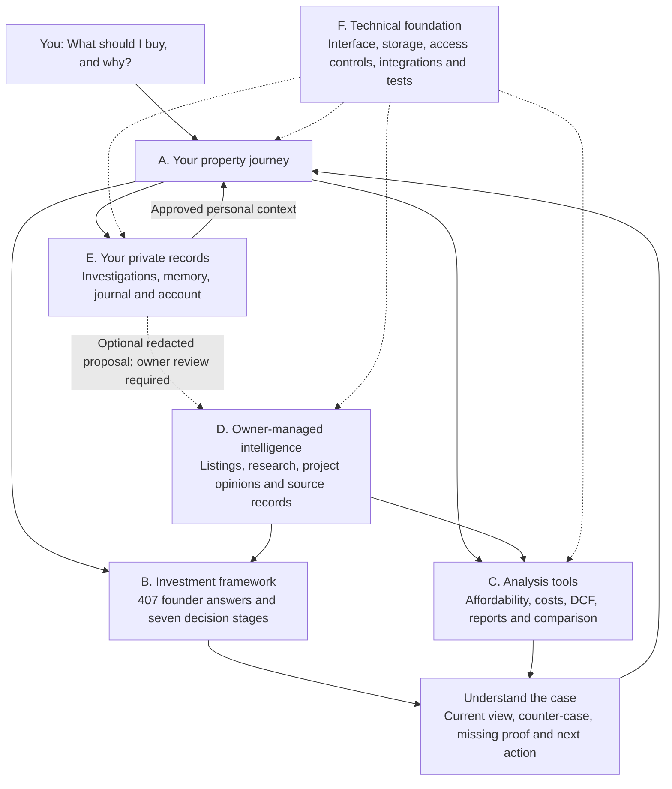
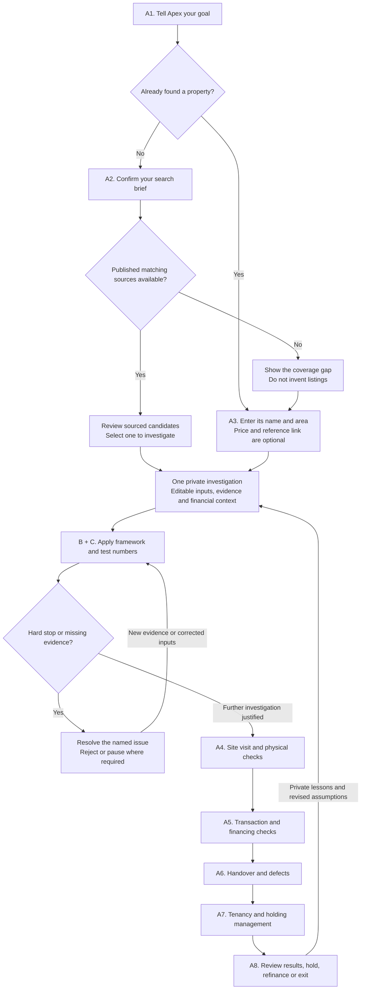
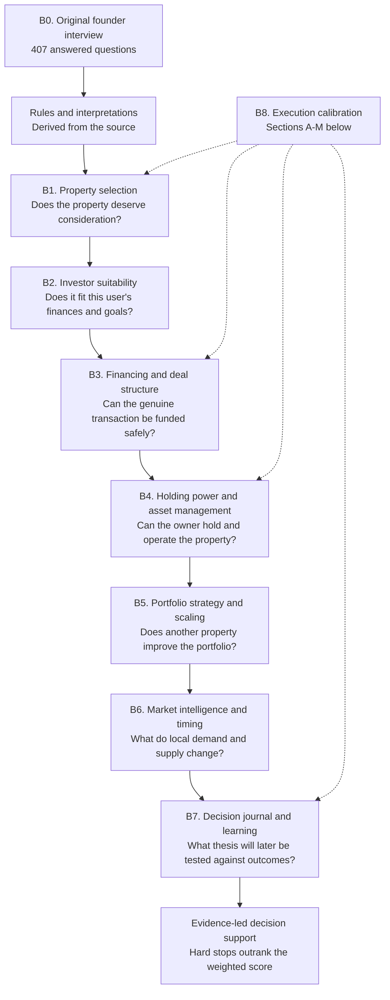
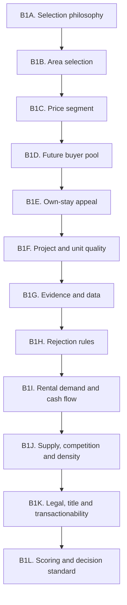
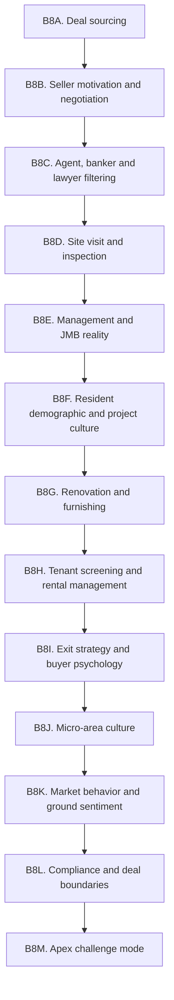
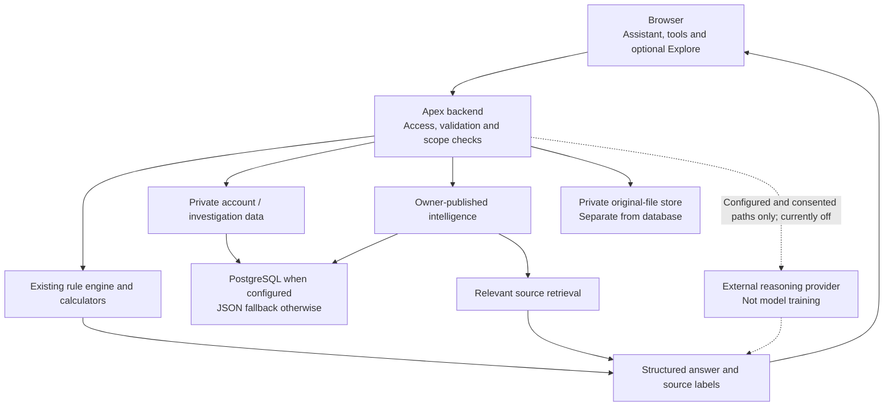

# Apex: User Map And Amendment Guide

Reviewed: 1 November 2026, Malaysia time. Source snapshot: `ab59e8524de5ddf3a085ee574c368e204e8ffc03` on `brandonkow/apexframework/main`.

This is a map of the existing repository, not a new framework or a proposed redesign. Section IDs below are amendment addresses, not additional product versions. The protected founder record and rules have not been changed.

## Start Here

In plain language, Apex is a property-investment decision workspace. You bring a property or search objective. It organizes your assumptions and evidence, applies the existing investment rules, identifies what needs checking, and keeps the investigation together through ownership and review.

It cannot visit a building, verify a seller, approve a loan, complete a purchase, or discover every property automatically. A good-looking score is not permission to buy.



**How to request an amendment:** name an ID and the behavior you want. For example: "Change C3 so the valuation comparison is easier to understand" or "Simplify A4 without removing mandatory site checks." You do not need to know the code filenames.

## What Exists Versus What Is Live

The repository contains all sections below. That does not mean every service is connected or every rule has been validated against real outcomes.

Public production status was checked on 1 November 2026 at `https://apex-jarvis-engine.vercel.app/api/assistant/status`:

| Capability | Observed status | What this means to a user |
| --- | --- | --- |
| Deterministic framework | Present in code; public service responds | Assess supplied inputs without an LLM; incomplete inputs remain incomplete. |
| Saved long-term records | `storage: json`, `durable: false` | Production records may disappear. Do not rely on them as permanent memory yet. |
| Discovery catalogue | 0 records; 0 current listings | The import/search workflow exists, but there is no published inventory to search. You can review your own property. |
| Private original documents/photos | Uploads disabled | Production needs durable database and private object storage. |
| External reasoning model | `llm: false` | Model integration remains deferred; no claim of model training or open-ended AI reasoning. |
| Billing, email delivery and server voice | Integration code exists; not verified in this map | A configuration or UI control is not proof the external service works. |

The status check was read-only. This mapping exercise did not create accounts, upload documents, perform financial transactions, or rerun the full application acceptance suite. Supabase setup remains deferred as requested.

## A. Your Property Journey

These are the steps a beginner experiences. They are not the seven investment-decision stages in section B.



Arrows show the intended workflow, not automatic completion. Users record actions and evidence; changing a stage does not approve a property or establish legal completion. Investor capacity can be discussed early, even though it is Stage 2 in the formal framework.

| ID | User-facing section | What is inside / what you can amend | Main implementation |
| --- | --- | --- | --- |
| A1 | Assistant and initial conversation | Greeting, brief collection, explanations, financial-intake prompts, response length, next question, optional voice behavior | `ui/assistant/assistant.js`, `assistant-profile.js`, `assistant-reasoning.js`, `investment-assistant.js`; shared chat/voice in `ui/workspace/features.js` and `server.js` |
| A2 | Find property candidates | Confirm location, price ceiling, type and bedrooms; search published sources; show coverage, freshness and duplicate handling; resume/cancel bounded background work | `investment-assistant.js`, `assistant-catalogue.js`, `assistant-jobs.js`, `assistant-routes.js` |
| A3 | Review a property you found | Minimal private-entry form; property identity; editable working inputs; preserved financial profile; synchronization and conflict handling | `assistant-property.js`, `assistant-context.js`, `ui/assistant/property-entry.js`, `ui/assistant/context-sync.js` |
| A4 | Site visit | Building, unit, management and resident-conduct observations; dated evidence; open checks and responsibilities | `investment-assistant.js`, `assistant-milestones.js`, `public/journey/levels.js`, `ui/assistant/milestones.js` |
| A5 | Transaction | Loan/legal readiness, seller authority, title, disbursement, professional responsibilities and document-backed dates | Same action-plan modules; rule details in B3 and B8L |
| A6 | Handover | Defect follow-up, keys/access/utilities and recorded completion evidence | Same action-plan modules; [ownership plan](OWNERSHIP_ACTION_PLAN.md) |
| A7 | Tenant and holding operations | Tenant/furnishing considerations, tenancy review, permitted condition checks, rent and actual costs | Action-plan modules, `assistant-learning.js`, `ui/assistant/learning.js`; B4 and B8G-H |
| A8 | Holding, refinance, exit and review | Compare the initial thesis with actual outcomes, reassess competition/cash flow, record next actions | `assistant-learning.js`, `assistant-reasoning.js`, `server.js`; B4-B7 and B8I |

**Shared action-plan behavior:** responsible role, target versus confirmed date, prerequisite checks, custom tasks, progress history and reopening dependent tasks. It does not send messages, book visits, pay bills, or automatically issue legal notices. There is no ongoing market-monitoring or calendar-reminder service in this workflow.

## B. The Investment Framework

### B0. Original answers and interpretation

[FOUNDER_407_QA.md](FOUNDER_407_QA.md) is the original question-and-answer record. The rule documents are interpretations built from it. `data/db.json` stores structured answers and beliefs; `rag/corpus.json` supports retrieval. Automatic source links are suggestions, not proof that a derived belief is correct.

The 407 answers are not a questionnaire every end user must complete. Not every nuance has been encoded as deterministic software. Preserve the original source when proposing changes; record a new interpretation or evidence-backed revision separately rather than rewriting history.



#### B1 in detail: property selection

All twelve sections below make up Stage 1. They take the reader from the investment thesis and local demand through price, quality, evidence, rental, supply and title to the decision standard.



#### B8 in detail: cross-stage execution calibration

These thirteen sections inform relevant decisions throughout the seven stages. They are a cross-stage layer, not another investment stage.



| ID | Stage | Founder answers | Rule document |
| --- | --- | ---: | --- |
| B1 | Property selection | 124 | [MY_INVESTMENT_FRAMEWORK.md](MY_INVESTMENT_FRAMEWORK.md) |
| B2 | Investor suitability | 20 | [INVESTOR_MANDATE_PROFILE.md](INVESTOR_MANDATE_PROFILE.md) |
| B3 | Financing and deal structure | 20 | [DEAL_STRUCTURING_FINANCING.md](DEAL_STRUCTURING_FINANCING.md) |
| B4 | Holding power and asset management | 27 | [HOLDING_POWER_ASSET_MANAGEMENT.md](HOLDING_POWER_ASSET_MANAGEMENT.md) |
| B5 | Portfolio strategy and scaling | 20 | [PORTFOLIO_STRATEGY_SCALING.md](PORTFOLIO_STRATEGY_SCALING.md) |
| B6 | Market intelligence and timing | 29 | [MARKET_INTELLIGENCE_TIMING.md](MARKET_INTELLIGENCE_TIMING.md) |
| B7 | Decision journal and learning | 27 | [DECISION_JOURNAL_LEARNING.md](DECISION_JOURNAL_LEARNING.md) |
| B8 | Cross-stage execution calibration, A-M | 140 | [EXECUTION_CALIBRATION.md](EXECUTION_CALIBRATION.md) |
| | Total | **407** | The unanswered appendix is not an additional answered stage. |

### B1 subdivisions: property selection

| Amendment ID | Section | Main question |
| --- | --- | --- |
| B1A | Selection philosophy | What counts as a valuable, quality-led investment? |
| B1B | Area selection | Is demand real, and what supports the location? |
| B1C | Price segment | Is the entry price appropriate for the local buyer pool? |
| B1D | Future buyer pool | Who can and will buy this unit later? |
| B1E | Own-stay appeal | Would someone actually want to live here? |
| B1F | Project and unit quality | Does the building, management and unit deserve confidence? |
| B1G | Evidence and data | Which sources and comparables deserve weight? |
| B1H | Rejection rules | What defeats a cheap price or attractive return? |
| B1I | Rental demand and cash flow | Is rent achievable and the holding position resilient? |
| B1J | Supply, competition and density | Can this property defend itself against substitutes? |
| B1K | Legal, title and transactionability | Can it be safely bought, financed and sold? |
| B1L | Scoring and decision standard | How do the findings become a qualified decision? This was delegated, not an extra set of founder answers. |

### B8 subdivisions: real-world execution

| Amendment ID | Section |
| --- | --- |
| B8A | Deal sourcing |
| B8B | Seller motivation and negotiation |
| B8C | Agent, banker and lawyer filtering |
| B8D | Site visit and physical inspection |
| B8E | Management and JMB reality |
| B8F | Resident conduct and project culture |
| B8G | Renovation and furnishing strategy |
| B8H | Tenant screening and rental management |
| B8I | Exit strategy and buyer psychology |
| B8J | Micro-area culture |
| B8K | Market behavior and ground sentiment |
| B8L | Compliance and deal boundaries |
| B8M | Calm, mentor-like challenge mode |

Cross-stage references: [FRAMEWORK_OVERVIEW.md](FRAMEWORK_OVERVIEW.md), [SECOND_BRAIN.md](SECOND_BRAIN.md), [APEX_DECISION_STANDARD.md](APEX_DECISION_STANDARD.md), [FOUNDER_SOURCE_TRACEABILITY.md](FOUNDER_SOURCE_TRACEABILITY.md). Gap/review documents and the separate enhancement question bank are listed in the inventory; they do not replace the 407-answer record.

## C. Analysis And Outputs

| ID | User question / tool | Existing contents | Where to amend |
| --- | --- | --- | --- |
| C1 | Can I afford it? | Income/debt/cash/reserve intake, DSR, installment and interest stress, separate property quality versus personal suitability | `assistant-profile.js`, `server.js`; Tools > Investor profile; [investor rules](INVESTOR_MANDATE_PROFILE.md) |
| C2 | What will it really cost? | Acquisition cash, stamp duty/legal/disbursement allowances, renovation/furnishing, recurring outgoings and exit-cost estimates | `server.js`; Tools > Property inputs; [financing rules](DEAL_STRUCTURING_FINANCING.md) |
| C3 | Is the purchase price justified? | Income-based DCF, comparable-sale adjustments, evidence gates, operating income versus financed buyer returns, five-year Excel output | `dcf-engine.js`, `dcf-workbook.js`, `ui/workspace/dcf-format.js`, `templates/residential-high-rise-buyer-dcf.xlsx`; Tools > Valuation lab |
| C4 | What is the decision and why? | Seven-stage assessment, four dimensions, hard stops, evidence gaps, source labels, contrary case, next action, printable report | `server.js` (`analyzeSevenStageDeal`), `structured-response.js`, `assistant-reasoning.js`, `ui/workspace/features.js` |
| C5 | What if conditions worsen? | Rental decline, financing stress, vacancy, repairs/reserves, holding-power envelope, portfolio capacity and exit assumptions | `server.js`; report sections; B3-B6 |
| C6 | How do my alternatives compare? | Candidate comparison, browser shortlist of up to four analyzed properties, saved-report comparison | `ui/journey/app.js`, `ui/workspace/features.js`, `server.js`; Compare and Library > Saved shortlist |
| C7 | Can the brain run without the website? | Read-only `apex.brain.v1` local interface; strict inputs; same framework and journey gates; no database or model calls. Separate authenticated integration contract for another workspace | `brain-engine.js`, `scripts/run-brain.js`, `examples/engine-candidate.json`, `contracts/residential-deal-review.v1.schema.json`; [brain interface](BRAIN_ENGINE.md), [integration API](RESIDENTIAL_DEAL_REVIEW_API.md) |

**C3 boundary:** DCF is initially an income-based screening value. A stronger market-value label requires the calculator's evidence gate; user-entered verification does not make the evidence independently verified. It is not a bank valuation or a formal professional valuation report.

**C4 output structure:** current view -> principal support -> strongest counter-case -> missing or contradictory evidence -> practical next action. The four dimensions are property quality, investor suitability, evidence quality, and market/exit. Scores summarize rules; they are not probabilities of profit.

### Where the older v1-v10 features live

These are historical implementation layers, not ten additional investment stages or ten compulsory screens. The application release number, engine version and founder-framework version are different identifiers.

| Layer | Included capability | Amendment home |
| --- | --- | --- |
| v1 | Deal assessment, comparison, diligence pack, execution calibration, stress, portfolio gate, timing, exit and decision seal | B, C4-C6 |
| v2 | Owner market intelligence, site assistance, sourcing/professional filter, tenancy and exit planning | A4-A8, D3-D4 |
| v3 | Approved memory, belief review, personalized challenges, prior-deal comparison, source transparency and memory conflict handling | E2-E3, D6, C4 |
| v4 | Transaction, rent, financing/valuation, supply, site/management and legal evidence lanes | B1G, C4, D2-D5 |
| v5 | Response persona, context prompts, input guidance, mobile/voice, feedback, answer style/refinement and session brief | A1, F1 |
| v6 | Trust acknowledgement, report boundaries, professional-review checklist and unsafe-deal/commercial safeguards | E5, C4, B8L-M |
| v7 | Project identity, substitute supply, rental direction, liquidity/auction, absorption, management, scarcity, local cycle and observation freshness | D3-D4; computed report lanes in `server.js` |
| v8 | Owner-document coverage/relevance, transaction/rental/legal/site proof, freshness, reliability, missing-file queue and evidence summary | D2, D5; `knowledge.js`, `research-study.js`, `server.js` |
| v9 | Capital, reserve runway, debt, holding power, concentration, sequence, refinance, opportunity cost and scale readiness | B5, C1, C5; computed report lanes in `server.js` |
| v10 | Thesis integrity, contradictions, hard-stop hierarchy, evidence, market/portfolio fit, challenge, professional handoff and compressed next action | B7, C4, A4-A8; `server.js` |

Names such as "watch", "radar" and "command" describe assessment/report sections here. They must not be read as proof of continuous live feeds, scheduled surveillance, automatic trading, or an autonomous investment committee.

## D. Owner-Managed Intelligence

Normal users cannot directly rewrite the shared framework or publish knowledge. Owner approval and source status matter separately from whether a file imports successfully.

| ID | Section | Existing contents / amendment choices | Main source |
| --- | --- | --- | --- |
| D1 | Discovery catalogue | Permission references, JSON imports, preview before publication, replacements/removals, stale preview protection, freshness and listing duplicates | `assistant-catalogue.js`, `investment-assistant.js`, `ui/assistant/assistant.js`, `public/assistant/catalogue-template.json`; [discovery](ASSISTANT_DISCOVERY.md) |
| D2 | Market research studies | Study scope, project/supply/transaction/evidence records, source confidence, comparable weights, metrics, reviewer gates and validated import | `research-study.js`, `skills/research-residential-markets/`; [research integration](RESEARCH_STUDY_INTEGRATION.md) |
| D3 | Market observatory | Dated project observations, metric history, freshness and trend context | `server.js`, `ui/workspace/features.js`; [market observations](MARKET_OBSERVATION_OPERATIONS.md) |
| D4 | Development cases | Owner opinions about named developments: strengths, weaknesses, fit, management, supply, rental/resale outlook and contrary evidence | `server.js`, `ui/workspace/features.js`; [development cases](DEVELOPMENT_CASE_LIBRARY.md) |
| D5 | Shared evidence vault and retrieval | Owner-only document ingestion, original storage, chunking, lexical retrieval, optional embeddings, source previews and retrieval monitoring | `knowledge.js`, `object-storage.js`, `server.js`; [retrieval](RAG.md), [operations](PRODUCTION_OPERATIONS.md) |
| D6 | Belief review and provenance | Original-answer imports, suggested versus owner-confirmed source links, confidence/review dates, contested/retired beliefs, redacted lesson proposals | `scripts/import-founder-answers.js`, `scripts/link-belief-sources.js`, `data/db.json`, `assistant-learning.js`, `ui/assistant/learning-owner.js`, `server.js` |

Research templates cover inception brief, project profile, report outline and development recommendation. Research schemas cover study configuration, evidence, projects, supply and transactions. Supporting Python scripts initialize studies, calculate metrics, score comparables, validate and export approved bundles. These are owner research tools, not an automatic external-data subscription.

## E. Your Private Records And Access

| ID | Section | What is inside / what can change | Main source |
| --- | --- | --- | --- |
| E1 | Continuing investigation | Conversation, selected-source snapshot, editable working copy, action plan, evidence, outcomes; explicit guest-to-account adoption; version conflicts | `assistant-routes.js`, `assistant-context.js`, `investment-assistant.js`, `storage.js` |
| E2 | Personal memory and conversation history | Account-approved memory, pending suggestions, preferences, review/delete/conflict controls, private conversation continuation | `server.js`, `ui/workspace/features.js`; Library > Long-term memory / Conversations |
| E3 | Decision journal and investigation learning | Report-based private journal plus case-based locked thesis, actual monthly outcomes, review snapshots, uncertainty and optional redacted lesson sharing | `server.js`, `assistant-learning.js`, `ui/assistant/learning.js`; [learning boundaries](INVESTIGATION_LEARNING.md) |
| E4 | Private evidence, export and recovery | Case-scoped originals and reviewed notes; permission controls; bounded document extraction; download/delete/cleanup; separate unverified recovery from JSON | `assistant-files.js`, `assistant-file-worker.js`, `assistant-recovery.js`, `ui/assistant/files.js`, `ui/assistant/recovery.js`, `object-storage.js` |
| E5 | Account, plans and trust | Sign-in, verification/reset, private report history, data export, Free/Pro/Advisor entitlements, metering, optional checkout/webhook, decision boundaries and owner account administration | `server.js`, `ui/workspace/panels.html`, `ui/workspace/features.js`; [authentication](AUTHENTICATION.md), [monetization](MONETIZATION.md) |

**Do not confuse three different things:** personal memory changes one user's context; owner-approved knowledge changes shared guidance; LLM training changes model weights. The first two have workflows in this repo. Automatic model training does not.

**Two learning records coexist:** the report-based Decision Journal and the investigation's Thesis & learning panel. They do not silently synchronize. Treat consolidation as a deliberate migration, not deletion of one screen without moving its records.

**Recovery is not authority:** restored inputs need review; previous approvals, file bytes and publication permissions are not restored as verified facts. A downloaded backup is separate from durable database storage.

## F. Interface And Technical Foundation

| ID | Section | What it controls | Main source |
| --- | --- | --- | --- |
| F1 | Navigation, layout and optional 3D | Assistant / Explore / Tools / Library / Owner Studio / Account; mobile layout; accessible controls; scene and checkpoint presentation | `public/index.html`, `ui/journey/`, `ui/workspace/`, `ui/assistant/`, public CSS, `public/journey/levels.js` |
| F2 | Backend and integration boundaries | Public versus account/owner/service APIs, request validation, response shaping, legacy route names, provider and voice adapters | `server.js`, `assistant-routes.js`, `api/router.js`, `structured-response.js`, `environment.js`, contract schema |
| F3 | Database and private originals | JSON/local fallback versus PostgreSQL; account/case isolation; transaction conflicts; private object-store adapter and file cleanup | `storage.js`, `object-storage.js`, [POSTGRESQL.md](POSTGRESQL.md), [PRIVATE_INVESTIGATION_FILES.md](PRIVATE_INVESTIGATION_FILES.md) |
| F4 | Build, deployment and configuration | Node dependencies, self-hosted bundle, source assets, Vercel/Render adapters and environment variables | `package.json`, `package-lock.json`, `scripts/build-journey.js`, `vercel.json`, `render.yaml`, `.env.example` |
| F5 | Safety checks and tests | Protected framework hashes; rule, calculator, source, scope, consent, concurrency, restore and provider tests; browser acceptance; read-only production readiness | `tests/`, browser-check scripts, `scripts/run-tests.js`, `scripts/smoke-test.js` |

### Actual workspace navigation

| Main area | Existing sections |
| --- | --- |
| Assistant | Conversation-led discovery/private review, continuing investigation, action plan, private evidence and thesis/learning |
| Explore | Optional seven-level 3D/list journey, checkpoint evidence and candidate comparison |
| Tools | Ask Apex; Property inputs; Investor profile; Valuation lab; Preferences |
| Library | Decision reports; Decision journal; Long-term memory; Conversations; Saved shortlist |
| Owner Studio | Intelligence hub; Discovery catalogue; Market observatory; Development cases; Evidence vault |
| Account | Account & plan; Decision boundaries |

These labels come from `public/index.html` and `ui/workspace/workspace.js`. Older documents sometimes describe the previous expandable-card UI; current navigation source wins when locating a screen.

### What flows where



Source code in `ui/` is bundled into `public/journey/app.js`; edit the source, not the generated bundle. `public/journey/fields.json` and the 3D scene/poster also have generation scripts/source assets. CSS and checkpoint definitions under `public/` are direct inputs, not all disposable build output.

## How We Should Amend One Section

1. Name the section ID and desired user outcome.
2. Identify whether the change concerns wording/layout, rule interpretation, calculation, evidence requirements, or data storage.
3. Preserve the original 407 answers. A proposed change to a protected rule needs explicit authorization and an explanation of what belief changes and why.
4. Check the linked UI, API, engine, records and tests together. A screen can be separate while its logic is shared.
5. Test a successful case, an incomplete case and a conflicting/adverse-evidence case. Never make a warning disappear just to make the screen easier to use.
6. Record what changed, what did not, and any migration or production dependency.

Useful requests:

```text
Section: C3 - Valuation lab
Problem: I cannot tell asking price from income value and sale evidence.
Desired behavior: Show the three separately before presenting a conclusion.
Keep unchanged: The DCF formula, evidence gates and original framework.
```

```text
Section: B1J - Supply and competition
New experience/evidence: [describe the case and dated sources]
Belief to test: [the specific assumption]
Requested change: Propose an interpretation first; do not overwrite my original answer.
```

## Important Amendment Boundaries

- The seven decision stages, six ownership lifecycle stages and historical v1-v10 software layers are different structures. Do not renumber one to make it look like another.
- A report verdict, journey checkpoint, final-command label and ownership task status are not interchangeable. Clearing a task does not establish investment approval.
- `server.js` contains much of the shared logic; `brain-engine.js` wraps that engine rather than replacing it. A narrow-looking calculator or report change can affect multiple entry points.
- `ui/workspace/features.js` also shares behavior across tools/library/owner views. Check both the assistant and workspace after changing shared inputs.
- A rule-document edit alone does not necessarily update engine calculations or the retrieval seed. Trace the specific rule through source, implementation and tests.
- A genuine independent market fact, an owner opinion, a user assumption and an AI inference need different labels.
- The core source is protected by hashes. Do not bypass those tests to make an unauthorized framework change appear valid.
- This map covers `apexframework`. It does not assert that the separate `apexanalytic` or `Core` repositories have been merged into it.

## Complete File Inventory

[REPOSITORY_FILE_INDEX.md](REPOSITORY_FILE_INDEX.md) accounts for every tracked file in the inspected source snapshot, grouped by purpose. It includes supporting scripts, fixtures, schemas, assets and historical documents that do not deserve separate end-user screens. Local dependencies, secrets, temporary outputs and Git internals are deliberately excluded.

This map is an orientation aid, not a fresh code/security audit or proof of investment performance. Production observations above are dated snapshots, not a promise that deployment configuration will stay the same.
